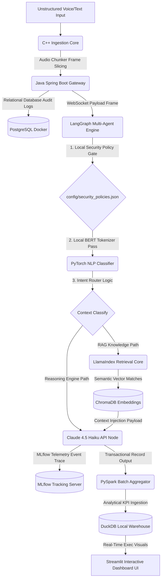

# NexusAI: Omni-Modal Enterprise AI Operations & Personalization Hub

NexusAI is a production-grade, multi-language enterprise architecture engineered to orchestrate autonomous workflows, ingest stream audio configurations, and route contextualized analytical information safely while running entirely with a zero-cost local footprint.

---

## System Architecture Topology



---

## Local Endpoint Port Matrix

| Service | Protocol / Target | Native / Local Host | Docker Container Port |
| :--- | :--- | :--- | :--- |
| **Java Enterprise Gateway** | REST Routing Services | `http://localhost:8080` | `8080` |
| **Python Orchestration Hub** | Async WebSockets Stream | `ws://localhost:8765` | `8765` |
| **MLflow Registry Tracking** | Experimentation Portal UI | `http://localhost:5001` | `5000` |
| **Streamlit Operations Plane** | Executive BI Dashboard | `http://localhost:8501` | `8501` |
| **PostgreSQL Instance** | Relational Ledger Records | `localhost:5432` | `5432` |
| **MongoDB Cluster Store** | State Trace Persistence | `localhost:27017` | `27017` |

---

## Microservice Core Competencies

### 1. High-Performance System Engineering (`C++` & `Java`)
- **Memory Optimization:** Slices incoming audio data stream arrays inside native `C++` pointers utilizing isolated frame chunk wrappers to avoid heap allocation overheads.
- **Enterprise Lifecycle Management:** Leverages `Java Spring Boot` as a decoupled multi-threaded transaction router hooking straight into containerized relational indices.

### 2. Generative AI & Agentic Orchestration (`Python` & `Anthropic`)
- **State Machine Topology:** Built using `LangGraph` to ensure deterministic execution bounds across AI security passes, local context lookups, and third-party API tool configurations.
- **Budget Maximization:** Intercepts incoming queries using quantized models (`Ollama`) for baseline categorization tasks, reserving your cloud budget exclusively for high-tier reasoning tasks.
- **Advanced Hybrid RAG:** Uses `LlamaIndex` to perform offline metadata parsing, semantic vector search, and custom embedding injection using localized configurations.

### 3. Data Cleansing & Analytical Operations (`Perl` & `PySpark`)
- **Responsible AI Compliance:** Employs an ultra-fast `Perl` text scanner script to sanitize legacy app text files, automatically tracking down and redacting sensitive PII parameters using regular expressions.
- **Distributed Analytics:** Coordinates localized single-node `PySpark` batch processing blocks to evaluate operational token expenditure trends and platform security statistics, persisting calculations inside an optimized-columnar `DuckDB` storage lake.

---

## Automated Quick Start Execution

To automate binary compilation, spin up structural background database meshes, run core validation unit tests, seed your analytical tables, and launch your front-end dashboards with a single command, execute the master orchestrator script:

```bash
chmod +x run_local_stack.sh
./run_local_stack.sh
```

- **Operational Control Panel UI:** `http://localhost:8501`
- **MLflow Tracking Dashboard:** `http://localhost:5001`
