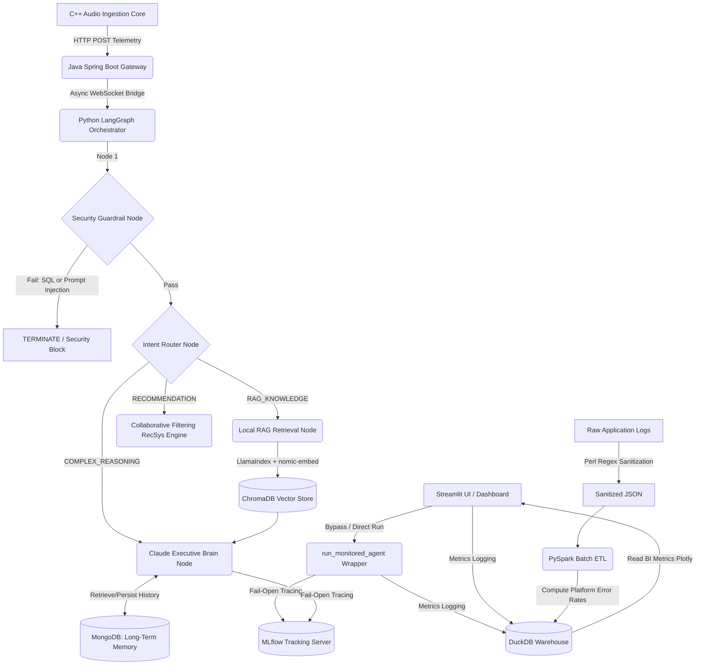

# NexusAI: Omni-Modal Enterprise AI Operations & Personalization Hub

NexusAI is a production-grade, multi-language enterprise architecture engineered to orchestrate autonomous workflows, ingest streamed audio configurations, and route contextualized analytical information safely while running entirely with a zero-cost local footprint.

---

## System Architecture Topology



---

## 📋 Prerequisites & System Requirements

Before running the NexusAI stack, ensure your local environment (`macOS` / `Linux`) has the following toolchains installed:

* **Containerization:** Docker Engine, Docker Compose, Minikube, `kubectl`
* **Programming Languages:** Python 3.10+, Java 17+ (with Maven), C++ Compiler (GCC/Clang), Perl 5+
* **Local AI Runtimes:** Ollama (must be active on port `11434`). 
  * *Note:* The infrastructure automation script utilizes `llama3.2:1b`, while internal system settings default to `qwen2.5:1.5b`. Ensure both models are cached locally:
    ```bash
    ollama pull llama3.2:1b
    ollama pull qwen2.5:1.5b
    ```
* **Environment:** Python Virtual Environment (`.venv`) configured for Python package matrices.

---

## 🚀 Execution & Deployment Strategies

NexusAI supports three distinct deployment targets depending on your testing or production needs.

### Option 1: Native Local Stack (Automated Verification)
To automate binary compilation, run core validation unit tests, seed analytical tables, and launch your front-end dashboards natively on your host:

```bash
chmod +x run_local_stack.sh
./run_local_stack.sh
```
> **Note:** This script binds background processes to your terminal execution state using a custom Bash `trap`. Press `CTRL+C` to gracefully terminate all child daemons safely.

### Option 2: Docker Compose (Containerized Microservices)
To run the entire network mesh in completely isolated Docker containers:

```bash
cd local_infra
docker compose down -v
docker compose up -d --build
```
*To view live multi-service system telemetry:* `docker compose logs -f`

### Option 3: Kubernetes / Minikube (Cloud-Native Emulation)
To deploy the Gateway and PostgreSQL instances to a local K8s cluster:

```bash
# Start your local cluster
minikube start

# Apply Infrastructure Manifests
kubectl apply -f local_infra/k8s/postgres-pv.yaml
kubectl apply -f local_infra/k8s/postgres-infra.yaml
kubectl apply -f local_infra/k8s/gateway-deployment.yaml

# Verify Pod Health
kubectl get pods

# Expose the Gateway Service to your local machine
kubectl port-forward svc/gateway-service 8080:8080
```

---

## 🧪 End-to-End Workflow Testing

Once the system is online, you can verify the end-to-end flow using the following interfaces:

### 1. Streamlit Operations Dashboard (`http://localhost:8501`)
* **Text Execution:** Enter a query like *"What are our rules about destructive database writes?"* to trigger deterministic security compliance validation.
* **Security Guardrails:** Enter *"DROP TABLE users"* to verify immediate zero-token `SECURITY_SHIELD` interception.
* **BI Analytics:** Watch the Right Panel dynamically update Token Expenditures and Intent Class pie charts via DuckDB integrations (`ui_analytics/analytics_warehouse.db`).


### 2. Audio Processing Pipeline (REST to WebSockets Gateway)
The Java Spring Boot Gateway handles dual modality types. You can test either client text strings or raw edge frames using curl:
* **Modality A: Standard Corporate Text Payload**

    ```bash
    curl -i -X POST http://localhost:8080/api/v1/gateway/dispatch \
        -H "Content-Type: application/json" \
        -d '{"query": "Check autonomous tool execution"}'
    ```
    * **Expected Output:** An HTTP `200 OK` response returning a serialized JSON contract tracking the `RAG_KNOWLEDGE` or `COMPLEX_REASONING` resolution.

* **Modality B: Simulated C++ High-Performance Edge Frame**
  ```bash
  curl -i -X POST http://localhost:8080/api/v1/gateway/dispatch \
    -H "Content-Type: application/json" \
    -d '{"frame_id": 1042, "amplitude_db": -12.4}'
  ```
  * **Expected Output:** The gateway converts this log structure internally into a standardized semantic query string: `"Audio telemetry trigger event. Frame ID: 1042 with Amplitude: -12.4 dB."`. The orchestrator catches this phrase and automatically re-routes it to fetch compliance documents via the `RAG_KNOWLEDGE` workflow node.


### 3. PySpark ETL & MLflow Auditing
* **ETL Job:** Execute `python3 data_pipeline/scripts/etl_spark_job.py` to aggregate raw metrics into the warehouse.
* **MLflow UI:** Navigate to `http://localhost:5001` to view sub-millisecond execution latency, parameter tracking, and precise token consumption metrics for every query trace.

---

## 🔌 Local Endpoint Port Matrix

| Service | Protocol / Target | Native / Local Host | Docker / K8s Port |
| :--- | :--- | :--- | :--- |
| **Java Enterprise Gateway** | REST Routing Services | `http://localhost:8080` | `8080` (NodePort: `30080`) |
| **Python Orchestration Hub** | Async WebSockets Stream | `ws://localhost:8765` | `8765` |
| **MLflow Registry Tracking** | Experimentation Portal UI | `http://localhost:5001` | `5001` (Maps to internal `5000`) |
| **Streamlit Operations Plane** | Executive BI Dashboard | `http://localhost:8501` | `8501` |
| **PostgreSQL Instance** | Relational Ledger Records | `localhost:5432` | `5432` |
| **MongoDB Cluster Store** | State Trace Persistence | `localhost:27017` | `27017` |

---

## 🧠 Microservice Core Competencies

### 1. High-Performance System Engineering (C++ & Java)
* **Memory Optimization:** Slices incoming audio data stream arrays inside native C++ pointers utilizing isolated frame chunk wrappers to avoid heap allocation overheads.
* **Enterprise Lifecycle Management:** Leverages Java Spring Boot as a decoupled, multi-threaded transaction router connecting to containerized relational data lakes via asynchronous processing queues.

### 2. Generative AI & Agentic Orchestration (Python & Anthropic)
* **State Machine Topology:** Built using LangGraph to ensure deterministic execution bounds across AI security passes, local context lookups, and role-based permissions access control.
* **Budget Maximization:** Intercepts incoming queries using quantized edge models (Ollama) for baseline categorization and security tasks, reserving cloud token consumption exclusively for high-tier reasoning via Anthropic Claude.
* **Advanced Hybrid RAG:** Uses LlamaIndex to perform offline metadata parsing, semantic vector search, and custom embedding injection via ChromaDB.

### 3. Data Cleansing & Analytical Operations (Perl & PySpark)
* **Responsible AI Compliance:** Employs an ultra-fast Perl text scanner script to sanitize legacy app text files, automatically tracking down and redacting sensitive PII parameters using regular expressions.
* **Distributed Analytics:** Coordinates localized single-node PySpark batch processing blocks to evaluate operational token expenditure trends and platform security statistics, persisting calculations inside an optimized-columnar DuckDB storage lake.