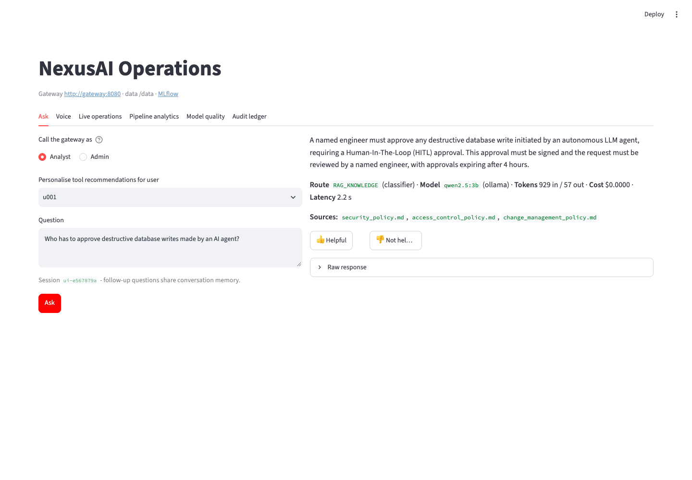
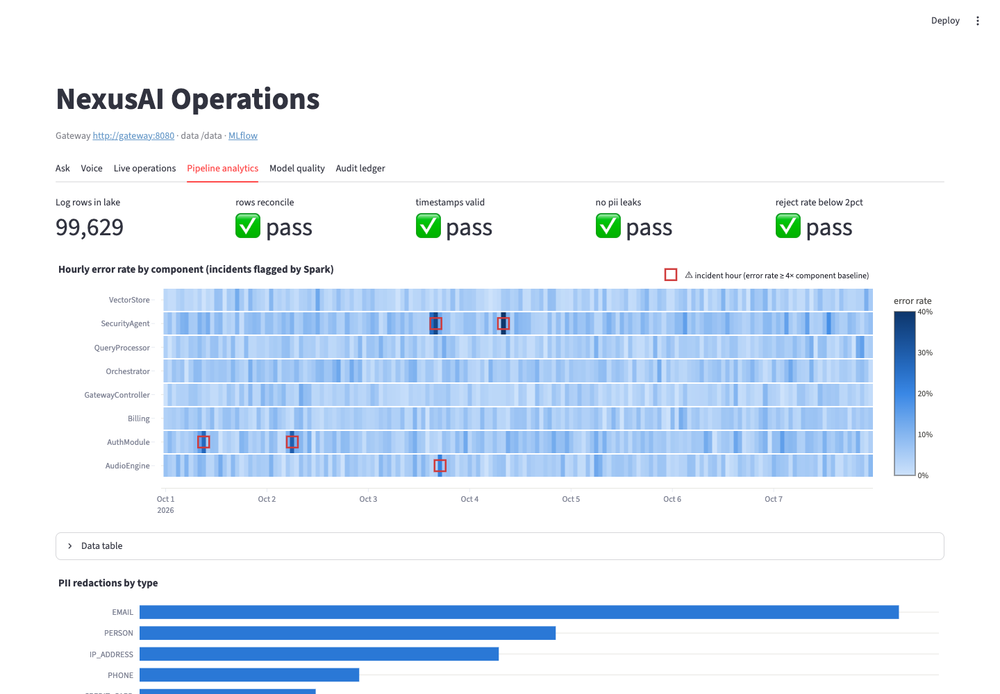
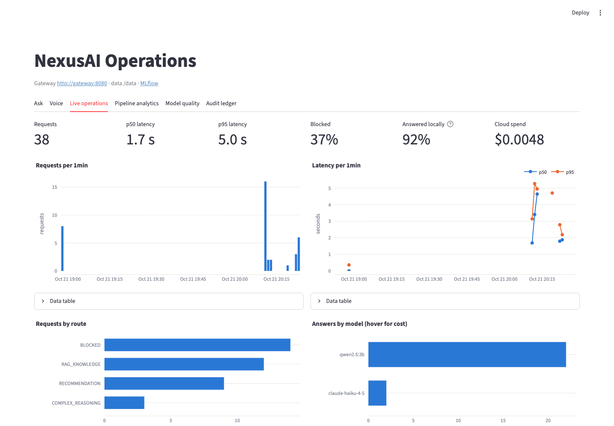
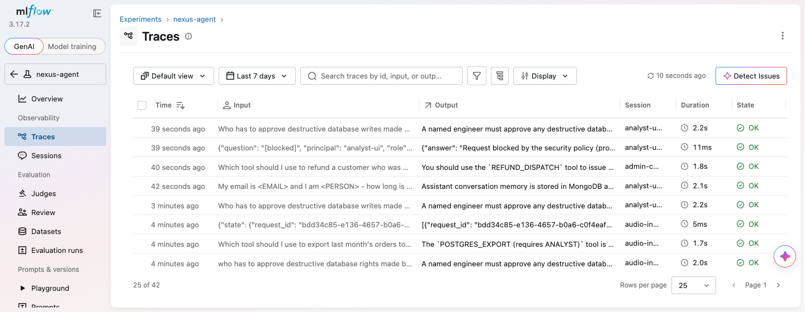
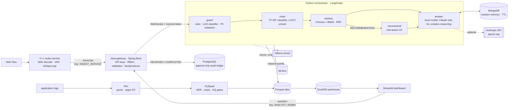

# NexusAI

[](https://github.com/vipin-mo/nexus-ai-hub/actions/workflows/ci.yml)

An internal AI assistant for a fictional company ("Nexus Corp"), built to show how one is operated, not
just how it is prompted. It covers authentication and an audit trail, prompt-injection defence and PII
redaction, measured routing and retrieval, an evaluation gate in CI, speech input, and a batch
analytics pipeline. Everything runs locally for free on Ollama; Claude is optional and capped.

**Languages:** Python · Java · C++ · Perl · SQL
**Stack:** LangGraph, LlamaIndex, ChromaDB, BM25, scikit-learn, spaCy, MLflow 3, Anthropic API, Ollama,
whisper.cpp, Spring Boot 4, PostgreSQL, MongoDB, PySpark, DuckDB, Streamlit, Docker, Kubernetes, GitHub Actions

| Measured result | Value | Sample |
|---|---|---|
| Answer fact recall: local qwen2.5:3b / Claude Haiku 4.5 | 90.6% / 96.9% | 32 golden questions |
| Answers citing the right document: local / Claude | 42.9% / 96.4% | 28 answerable questions |
| Claude cost of a test run that sent all 32 answers to Claude | $0.039 | by default only `COMPLEX_REASONING` uses Claude |
| Prompt-injection attacks blocked: dev / held-out set | 97% / 75% (95% CI 53-89%) | 33 / 20 attacks |
| Benign questions wrongly blocked on the held-out set | 5% (1 of 20; 95% CI 1-24%) | 20 benign |
| Intent routing accuracy (classifier + qwen2.5:3b fallback) | 90.0% | 60 hand-written queries |
| PII redaction recall over 200k log lines (structured / names) | 100% / 94.9% | 95.8k inserted PII values |
| Speech-to-text (whisper.cpp on Metal) / word error rate | 50 ms per 3.7 s clip / 7.4% | 5 TTS clips, 54 words |
| Gateway path without a model call, 32 clients | 342 req/s, p50 86 ms | 400 requests |
| End-to-end answer latency through the gateway (laptop, warm) | p50 1.8 s, p95 2.2 s | 8 questions |

The samples are small, so read the percentages with the counts next to them. All numbers, how they
were measured and their caveats are in **[BENCHMARKS.md](BENCHMARKS.md)**.

| Ask (through the gateway, with sources) | Pipeline analytics (incidents found by Spark) |
|---|---|
|  |  |
| **Live operations (latency, routes, local vs cloud)** | **MLflow traces (PII redacted before export)** |
|  |  |

More: [evaluation results](docs/images/dashboard_model_quality.png) · [audit ledger](docs/images/dashboard_audit.png)

## Architecture



| Component | What it does | How it is verified |
|---|---|---|
| `core_engines/audio-processor-cpp` | Watches an inbox, decodes WAV (any rate, mono/stereo), detects speech with an energy VAD over zero-copy `std::span` frames, transcribes with whisper.cpp, posts to the gateway with retries | ctest (7 groups), WER script, `--bench` |
| `core_engines/gateway-service-java` | API-key auth (SHA-256 hashes), roles → permissions, deny by default; audit ledger written before forwarding (fail-closed) and protected by a DB trigger; bounded in-flight requests | 17 tests incl. Testcontainers PostgreSQL |
| `ai_orchestrator` | LangGraph workflow: guard → route → retrieve → (recommend) → answer. Model tiering keeps lookups on the free local model. PII is redacted before any model, store or trace sees it | 57 offline tests |
| `evals` | 210 labelled cases across five suites, logged to MLflow (`mlflow.genai.evaluate`), thresholds that fail CI | `make eval`, `make eval-local` |
| `data_pipeline` | Synthetic logs with known PII → Perl → Spark (NER, Parquet lake, marts, incident detection, data-quality gates) → DuckDB. Spark has only run in local mode (`local[*]`) on one machine | DQ gates fail the job; PII recall script |
| `ui_analytics` | Ask (via the gateway), voice upload, live operations, pipeline analytics, eval results, audit ledger, 👍/👎 feedback to MLflow | Streamlit AppTest, screenshots |
| `local_infra` | Docker Compose (7 services + batch job) and Kubernetes (kustomize, probes, limits, restricted pod security) | deployed on minikube: all 7 pods ready, a query answered through the gateway, RBAC checked ([output](docs/evidence/minikube_run.txt)) |

## Run it

Prerequisites: Docker, Ollama, Python 3.11, Java 17, CMake, Perl. About 10 GB of free RAM.

```bash
make env       # .env with random secrets (or --merge into an existing one)
make models    # ollama pull qwen2.5:3b nomic-embed-text llama3:8b; whisper base.en
make setup     # .venv, router training, C++ build
make up        # Postgres, Mongo, MLflow, orchestrator, gateway, audio service, dashboard
make demo      # questions, an injection, RBAC checks and the sample WAVs, end to end
```

Then open the dashboard at http://localhost:8501, MLflow at http://localhost:5001, and the API at
http://localhost:8080. If another project already uses a port, override it, for example
`NEXUS_DASHBOARD_PORT=8502 make up` (also `NEXUS_GATEWAY_PORT`, `NEXUS_MLFLOW_PORT`,
`NEXUS_POSTGRES_PORT`, `NEXUS_MONGO_PORT`). `make help` lists everything else: tests, evals, the
pipeline, benchmarks and Kubernetes.

Kubernetes (minikube): `make up` once to build the images, then `minikube image load nexus/python:latest
nexus/gateway:latest nexus/audio-processor:latest`, copy `local_infra/k8s/secrets.env.example` to
`secrets.env`, fill it in and run `kubectl apply -k local_infra/k8s`. minikube keeps volume data under
`/tmp/hostpath-provisioner/nexus` even after the namespace is deleted, so if you change the database
passwords, delete that directory too or Postgres will reject the new ones.

Claude is optional: put `ANTHROPIC_API_KEY` in `.env`, set `NEXUS_REASONER_PROVIDER=anthropic` and rerun
`make up`. Only `COMPLEX_REASONING` requests go to Claude, and each process stops calling it after
`NEXUS_SPEND_CAP_USD` (default $2) and answers locally instead. `make eval` and the tests never call it.

```bash
curl -s localhost:8080/api/v1/query -H "Content-Type: application/json" \
  -H "X-API-Key: $(grep NEXUS_ANALYST_API_KEY .env | cut -d= -f2)" \
  -d '{"query": "Who has to approve destructive database writes made by an AI agent?"}'
```

## ML/AI Ops

- **Evaluation gate.** Every push runs the offline suites (deterministic: fake LLM, hashing embeddings)
  and fails if a metric drops below `evals/thresholds.yaml`. `make eval-local` runs the same suites on
  real local models, with an LLM judge.
- **Tracing.** Every request is an MLflow trace (graph nodes, retrieval, model calls, token usage).
  Tracing is fail-open with a 1.5 s health probe, and a span processor redacts PII in every span before
  export. The authoritative audit record is the Postgres ledger.
- **Model registry.** The intent router is trained, scored on a hand-written challenge set and
  registered as `nexus-intent-router`. A new version becomes `@champion` only if it matches or beats the
  current one on the challenge set; otherwise it is `@challenger`.
- **Prompt registry.** Prompts are versioned in MLflow under `@production`; the runtime can load them
  from the registry and fall back to the code version.
- **Cost control.** Real token counts and cost per request, route and model, plus a per-process spend
  cap with fallback to the local model.
- **Feedback.** Dashboard ratings are attached to the request's MLflow trace.

## Design decisions

- **A workflow, not an open-ended agent.** The graph's shape is fixed and tested; models decide the
  route and write the answer. For policy Q&A with access control this is easier to secure and evaluate
  than a free-running tool loop.
- **Every request is grounded.** Misrouted policy questions were answered from the model's imagination,
  so retrieval now runs on every route. The route decides the recommender and the model tier.
- **Local first.** One ~2 GB model handles every local task. On a 16 GB laptop, using llama3:8b as the
  scanner as well pushed the machine into swap and raised p50 latency through the gateway from 1.8 s to
  7.6 s.
- **Defence in depth that is measured.** Regex rules generalised poorly (15% on the held-out set), so a
  classifier backs them up. Access control is enforced in code (recommender filter, an answer check),
  because the model recommended admin-only tools even when told the caller's role.
- **Spark where it is not needed.** At 200k lines DuckDB computes the same mart 50x faster. Spark is
  there to show a job written to scale out; it has only been run in local mode, never on a cluster.

## Limitations

- The documents, logs, usage events and evaluation sets are synthetic and small.
- Held-out injection recall is 75% on 20 attacks (95% CI 53-89%): new phrasings still get through. The
  guard is one layer, not a guarantee.
- Groundedness is near the top of its scale with both a local and a Claude judge, so it does not
  separate configurations well on this dataset; fact recall and citations do.
- Audio is file-based (an inbox), not live streaming; the speech samples are TTS voices.
- The Kubernetes setup targets a single-node cluster (ReadWriteOnce volumes, SQLite-backed MLflow) and
  has only been run on minikube. Spark has only run in local mode.

## Repository layout

```
ai_orchestrator/   LangGraph agent, guard, PII, router, retrieval, recommender, memory, server
evals/             evaluation suites, datasets, thresholds
core_engines/      C++ audio service, Java gateway
data_pipeline/     log generator, Perl parser, Spark job, warehouse loader, benchmarks
ui_analytics/      Streamlit dashboard
local_infra/       docker-compose.yml, k8s/ (kustomize)
scripts/           env generator, demo, benchmarks, WER, model download
docs/images/       screenshots used in this README
docs/evidence/     captured output (minikube run)
```

MIT licensed. All company names, people and documents are fictional.
