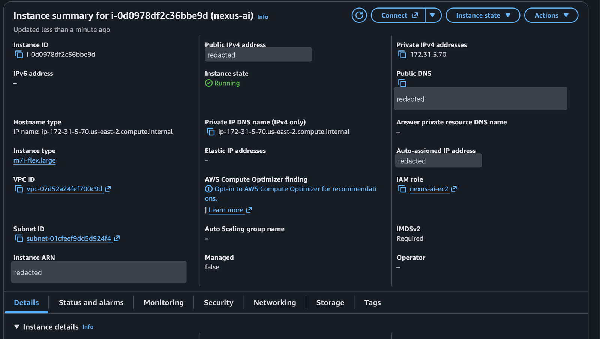
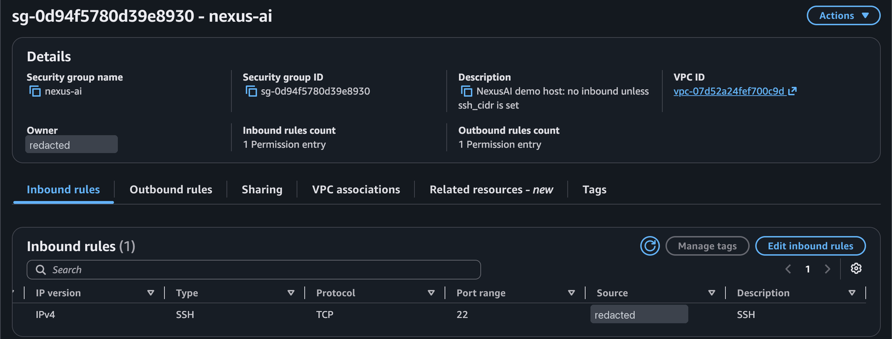
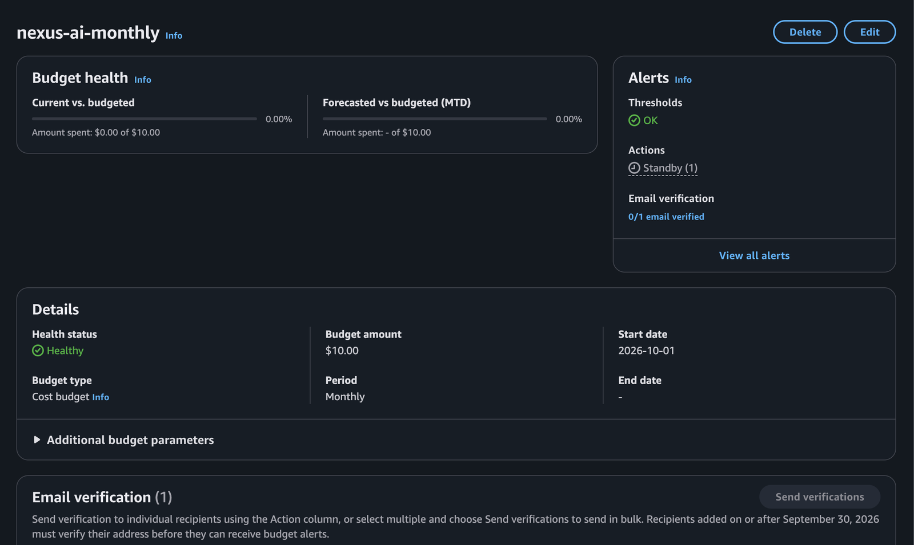
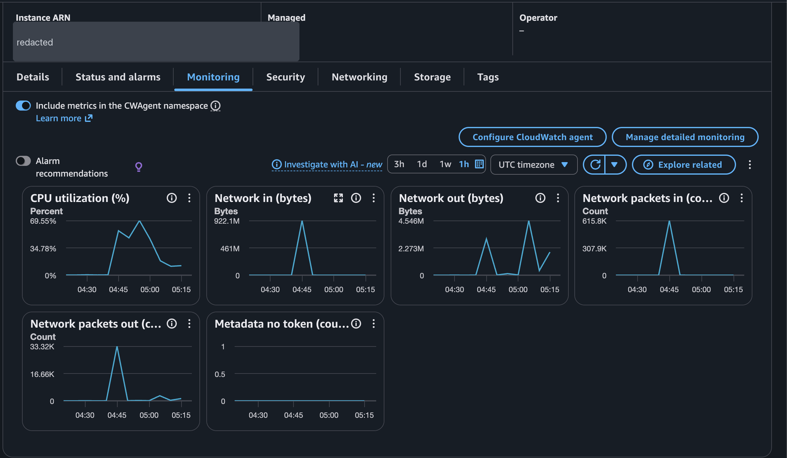
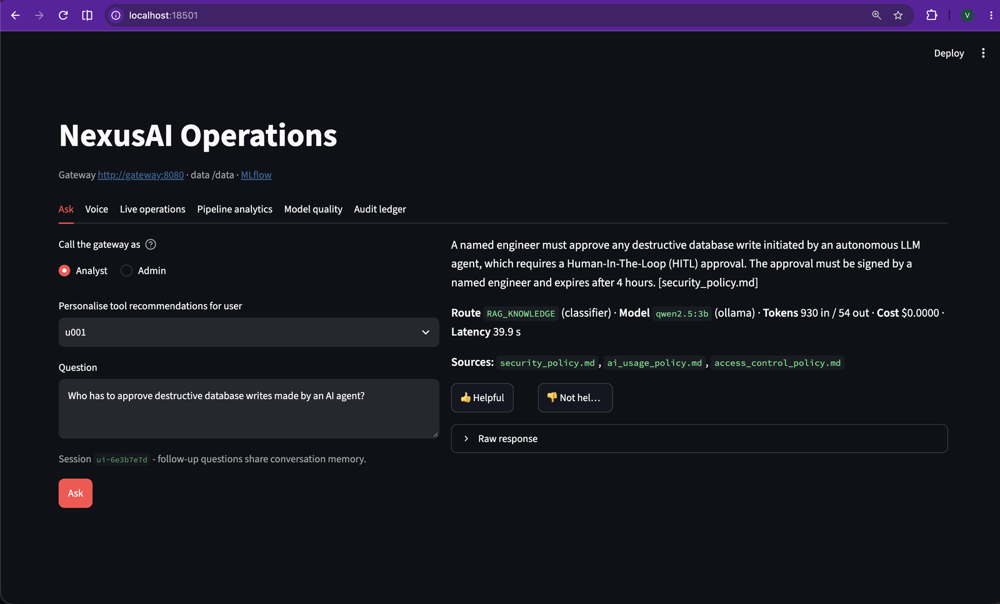
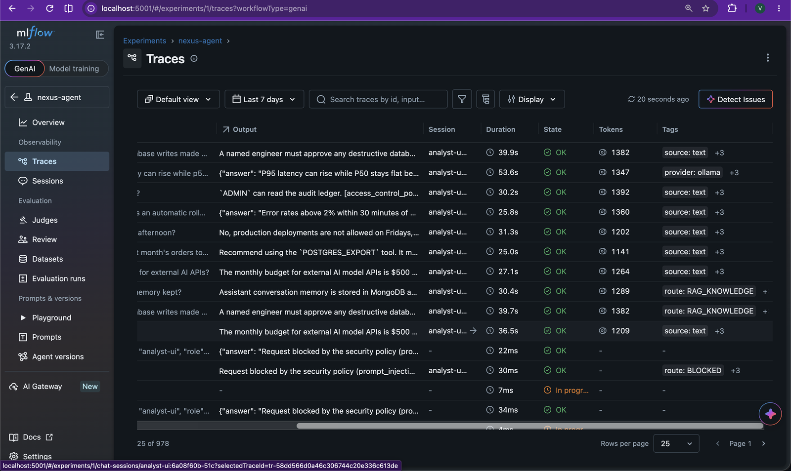

# Deploying to AWS (one EC2 instance)

The whole stack runs on one Graviton instance with Docker Compose, the same as on a laptop, with
Ollama on the host. There is no load balancer, NAT gateway or EKS cluster: for a demo they would
cost more per month than the instance itself.

```
your laptop ──Session Manager port forward──▶ EC2 t4g.xlarge (default VPC, no inbound ports)
                                               ├─ Ollama: qwen2.5:3b, nomic-embed-text
                                               └─ Docker Compose: 7 services, all on 127.0.0.1
```

| Resource | Why |
|---|---|
| `t4g.xlarge` (4 vCPU, 16 GB, ARM) | Ollama plus seven services need about 10 GB; ARM matches the images built on Apple silicon and is cheaper per GB |
| Security group with no inbound rules | Access is through Session Manager, so nothing is exposed; SSH from one IP is opt-in (`ssh_cidr`, `ssh_public_key`) |
| 4 GB swap file (`swap_gb`) | Headroom for image builds and model loading; needed on 8 GB instances |
| IAM role with `AmazonSSMManagedInstanceCore` only | Lets Session Manager reach the instance; no other AWS permissions |
| Encrypted 50 GB gp3 root volume, IMDSv2 only | Images, models and databases; blocks the old metadata API |
| Auto-stop `auto_stop_hours` (default 3) after every boot | A forgotten instance stops itself; shutdown means stop, never terminate |
| Optional monthly budget (`budget_email`) with a stop action | Email at 80% of `budget_usd`; at 100% AWS Budgets stops the instance |

Secrets are generated on the instance at first boot (`scripts/generate_env.sh`) and never leave it.
Claude is off: no Anthropic key is deployed.

## What the first deployment looked like

Deployed on 2026-10-28 to an AWS Free plan account (`m7i-flex.large`). Account ID and public
addresses are redacted. Measurements: [docs/evidence/aws_run.txt](../../docs/evidence/aws_run.txt).

| Instance (IMDSv2 required, role with SSM only) | Security group: SSH from one /32, nothing else |
|---|---|
|  |  |
| **Budget with the stop action armed** | **CPU during first boot, demo and benchmark** |
|  |  |
| **Answer with sources (39.9 s on 2 vCPUs)** | **MLflow traces from the instance** |
|  |  |

## Cost (us-east-2, on-demand)

| State | Approximate cost |
|---|---|
| Running | about $0.145 per hour: instance $0.134, public IPv4 $0.005, volume $0.0055 |
| Running at full CPU | up to about $0.24 per hour: CPU above the 40% baseline adds about $0.04 per vCPU-hour (`unlimited` credits) |
| Stopped | about $4 per month for the 50 GB volume; the public IPv4 address is released |
| Destroyed | $0 |

Left running for a month, the instance would cost about $105. The guards are there for that case.
On a Free plan account with `m7i-flex.large` (not burstable), running is about $0.11 per hour in
total.

## Cost guards

AWS has no hard spending cap, so there are two layers:

1. **Auto-stop on the instance.** A systemd unit installed at the very start of first boot schedules a
   shutdown `auto_stop_hours` after every boot, and `instance_initiated_shutdown_behavior = "stop"`
   makes that a stop. One forgotten session costs at most about 3 x $0.24 = $0.72. Starting the
   instance again starts a new 3-hour window. To keep a session going on the instance:
   `sudo shutdown -c && sudo shutdown -P +120`.
2. **Budget action.** With `budget_email` set, a monthly cost budget emails at 80% and, at 100%, runs
   the AWS-StopEC2Instance automation through a role that has only the AWS managed policy for budget
   actions. The budget measures usage **before credits**; by default budgets subtract credits, so
   with $100 of credits the actual cost would stay at $0 and nothing would fire. This is a backstop:
   billing data lags by several hours, and the action runs once per budget period.
   AWS requires budget email recipients added on or after 2026-09-30 to verify their address: open
   the budget in the Billing console and choose **Send verifications**, or the alerts are not
   delivered. On an organisation-managed account this can be blocked ("You do not have permission
   to send verification emails", `notifications-contacts:*`); then budget emails are not available
   and the on-instance auto-stop is the guard to rely on.

Stop or destroy between demos:

| | Stop and start | Destroy and apply again |
|---|---|---|
| Idle cost | about $4 per month | $0 |
| Ready in | 2-3 minutes | about 8 minutes (full first boot, measured on m7i-flex.large) |
| Data and API keys | kept | wiped; new keys in `/opt/nexus/.env` |

Stop between demos in a week with interviews; destroy if it will be idle for more than about a week.

## Deploy from AWS CloudShell

CloudShell already has credentials for the account. Terraform is installed into `~/bin` because
CloudShell keeps only the home directory between sessions. The home directory is limited to 1 GB and
the AWS provider plugin alone is several hundred MB, so `TF_DATA_DIR` puts the plugins in `/tmp`.

```bash
mkdir -p ~/bin && cd ~/bin
V=1.17.0; A=$(uname -m | sed 's/x86_64/amd64/;s/aarch64/arm64/')
curl -fsSLO https://releases.hashicorp.com/terraform/$V/terraform_${V}_linux_$A.zip
unzip -o terraform_${V}_linux_$A.zip terraform && rm terraform_${V}_linux_$A.zip
export PATH=~/bin:$PATH TF_DATA_DIR=/tmp/nexus-tf

cd ~ && git clone https://github.com/vipin-mo/nexus-ai-hub.git && cd nexus-ai-hub/deploy/aws
terraform init
terraform plan -var budget_email=you@example.com
terraform apply -var budget_email=you@example.com
```

The state file stays in `~/nexus-ai-hub/deploy/aws/` in CloudShell. Keep it: `terraform destroy`
needs it. (CloudShell deletes home directories after 120 days without use.) `/tmp` is cleared when a
session ends, so in a new session run this before any other `terraform` command:

```bash
export PATH=~/bin:$PATH TF_DATA_DIR=/tmp/nexus-tf && cd ~/nexus-ai-hub/deploy/aws && terraform init
```

First boot installs Docker and Ollama, pulls the models and builds the images. On m7i-flex.large it took
about 8 minutes (52 s for packages, Docker and Ollama; 6 min 42 s for models, image builds and
start-up). CloudShell closes idle sessions after about 20 minutes, so follow the log over SSH if you
use it. To watch it:

```bash
aws ssm start-session --region us-east-2 --target "$(terraform output -raw instance_id)"
sudo tail -f /var/log/nexus-bootstrap.log     # finished when it prints "nexus bootstrap finished"
```

## Use it from your laptop

**With AWS credentials on the laptop** (an IAM user, or SSO / access keys from your access portal):
install the AWS CLI and the
[Session Manager plugin](https://docs.aws.amazon.com/systems-manager/latest/userguide/session-manager-working-with-install-plugin.html),
then run `terraform output dashboard` (or `gateway`) and paste the command. It forwards the port to
your laptop, and the dashboard opens at http://localhost:8501.

**Without AWS credentials on the laptop** (for example a federated account with no access keys): use
SSH with your own key, open only to your current IP. Set this up before the first `apply`: adding a
key to an existing instance replaces it.

```bash
# On the laptop
ssh-keygen -t ed25519 -f ~/.ssh/nexus-ai -N "" -C nexus-ai   # once
cat ~/.ssh/nexus-ai.pub                                       # public key: safe to paste
curl -s https://checkip.amazonaws.com                         # your public IP (not CloudShell's)

# In CloudShell
terraform plan -out nexus.plan -var budget_email=you@example.com \
  -var ssh_public_key="ssh-ed25519 AAAA... nexus-ai" -var ssh_cidr=<your IP>/32
terraform apply nexus.plan
terraform output -raw public_ip | sh       # the address changes on every stop/start

# On the laptop: keep this running, then open http://localhost:8501 (MLflow on 5001, API on 8080)
ssh -i ~/.ssh/nexus-ai -N -L 8501:localhost:8501 -L 8080:localhost:8080 -L 5001:localhost:5001 ubuntu@<public IP>
```

If a local port is taken, change the left-hand number for the dashboard or the API (for example
`-L 18501:localhost:8501`). Keep MLflow on local port 5001: it only accepts the host names in its
`--allowed-hosts` list and answers 403 on other ports.

When your IP changes (another network), plan and apply again with the new `ssh_cidr`; only the
security group rule changes.

To run the demo script on the instance:

```bash
cd /opt/nexus && sudo -u ubuntu make demo
```

## Stop, start, destroy

```bash
terraform output -raw stop | sh       # between demos; containers come back on start
terraform output -raw start | sh
terraform destroy                     # removes everything, including the databases
```

## If something is blocked

The account belongs to an organisation whose policies deny some actions (only us-east-2 is open).
If `apply` fails with `explicit deny in a service control policy`:

- On `budgets:*`: leave out `budget_email` and set a budget in the Billing console instead. If only
  the budget action is denied, keep the budget and add `-var budget_stop_action=false`.
- If Session Manager does not connect: use the SSH setup above.

If `RunInstances` fails with `The specified instance type is not eligible for Free Tier`, the account
is on the AWS Free plan, which only launches free-tier eligible types. List them with:

```bash
aws ec2 describe-instance-types --region us-east-2 --filters Name=free-tier-eligible,Values=true \
  --query 'InstanceTypes[].[InstanceType,VCpuInfo.DefaultVCpus,MemoryInfo.SizeInMiB]' --output table
```

The largest is usually `m7i-flex.large` (2 vCPU, 8 GB, x86). Add `-var instance_type=m7i-flex.large`
to `plan`: the x86 Ubuntu image is chosen automatically and the default 4 GB swap file covers the
memory peaks. Expect answers to take several times longer than on `t4g.xlarge`, because the model
runs on 2 vCPUs. The other option is upgrading the account to the paid plan, if your organisation
allows it.
